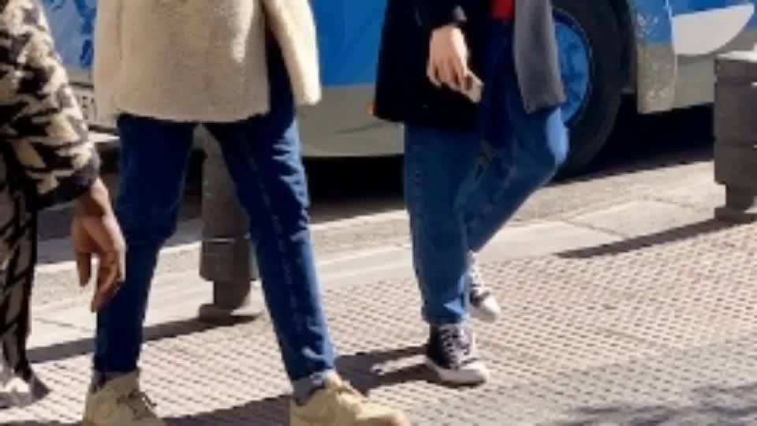

# 端侧视频 AI 自动剪辑（RK3588S）

在 Orange Pi 5 Pro（RK3588S，6 TOPS NPU）上离线完成「看素材 → 找主角 → 剪成片」：
YOLOv8n 跑 NPU 做检测，BoT-SORT 跟踪，HSV/OSNet 外观特征维持 ID，美学指标打分，
最后按 1 秒粒度滑窗选出高光片段，用 FFmpeg 精确切割并无损拼接。

整条链路不依赖云服务，素材不出设备。



## 实测（Orange Pi 5 Pro / RK3588S / 12s 960×540 素材）

| 项目 | 数值 |
|---|---|
| 检测后端 | RKNN / NPU（YOLOv8n FP16） |
| 单帧检测 | p50 **112 ms** / p90 **120 ms** |
| 分析采样率 | 6 fps（可配 `--analysis-fps`） |
| 分析 pass | 12.2 s（72 帧，含检测/跟踪/ReID/美学） |
| 出片 pass | 0.88 s（5 s 成片，FFmpeg 切割 + 拼接） |
| 选中片段 | 7.0–12.0 s（主角占比 1.0，片段分 0.93） |
| 成片 | 5.0 s |

> 12s 素材端到端约 13s：检测是瓶颈（112ms/帧）。把 `--analysis-fps` 降到 3
> 或换 INT8 权重可以进一步压缩；这里保留 6fps 是为了不在快速运镜时漏掉主体。
> 原始报告见 `assets/report_demo.json`。

## 流水线

```
decode (FFmpeg / h264_rkmpp) ──► 分层采样
        ├── 每帧       : YOLOv8n(NPU) → BoT-SORT(Kalman+IoU+外观+GMC)
        ├── 每 2 帧    : 外观特征（HSV 直方图 / 可选 OSNet-RKNN）
        └── 每 12 帧   : 美学打分（清晰度/色彩/曝光/构图/主体占比）
                                   │
                     主角识别（曝光时长+中心度+清晰度+主体显著性）
                                   │
                     1s 桶显著性 × 画质 → 滑窗选段 → EDL
                                   │
              FFmpeg 精确切割（统一编码参数）→ concat 无损拼接
```

设计取舍：

- **分层采样**：检测最贵、画质变化最慢，所以检测 6–12fps、美学 1fps。
  比"每帧全模型"省 5～10 倍算力，这是端侧做剪辑的关键。
- **主角 ≠ 出现最久**：`protagonist_score = 0.34×时长 + 0.28×中心度 + 0.20×清晰度
  + 0.10×正脸 + 0.08×置信度`，避免"背景路人"和"边缘半张脸"被误判为主角。
- **片段评分用显著性而非 track id**：硬切场景里 ID 会重建，按 ID 统计主角占比会抖；
  改用"该秒内人物显著性（中心度 × 主体尺寸）"，跨镜头也成立。
- **滑窗选段**：早期用"阈值分组"会把全片并成一段，再被 `max_clip` 从 0s 砍断，
  结果恰好丢掉最精彩的后半段；滑窗按窗口均分选段，稳定得多。
- **两 pass**：pass1 只做分析与决策，pass2 才解码出片；决策与渲染解耦，方便调参复用。

## 目录

```
editor/
  backends.py   RKNN / ONNX Runtime 双后端 + letterbox
  detector.py   YOLOv8 解码（单输出 + DFL 多尺度两种导出格式都支持）+ NMS
  tracker.py    BoT-SORT：8 维 Kalman、IoU+外观两级匹配、ORB 全局运动补偿
  reid.py       外观特征（HSV 直方图；给了 OSNet 权重则走深度特征）
  aesthetics.py 清晰度/色彩/曝光/对比度/构图打分
  highlight.py  主角识别、片段评分、EDL 生成
  video_io.py   FFmpeg 封装（rkmpp 硬解/硬编，自动回退 libx264）
  pipeline.py   分析 pass + 出片 pass
scripts/
  make_demo_clip.py   合成测试素材（三档变焦）
  run_edit.py         命令行入口
  convert_yolo_rknn.py  ONNX → RKNN（x86）
```

## 复现

```bash
# 板端
python3 -m venv --system-site-packages ~/mm_env
~/mm_env/bin/pip install rknn-toolkit-lite2==2.3.2 opencv-python-headless numpy

# 素材与模型
~/mm_env/bin/python scripts/make_demo_clip.py --image data/sample.jpg --out data/demo_3scenes.mp4
# models/yolov8n.rknn 由 scripts/convert_yolo_rknn.py 在 x86 上转换（见脚本注释）

# 跑
~/mm_env/bin/python scripts/run_edit.py \
    --input data/demo_3scenes.mp4 --output output/final_cut.mp4 \
    --backend rknn --model models/yolov8n.rknn --analysis-fps 6 \
    --report output/report.json
```

x86 上调试可换 `--backend onnxruntime --model models/yolov8n.onnx`，上层代码不变。

## 已知限制

- 演示素材是合成片段（`data/sample.jpg` 三档变焦），不含真实拍摄素材。
- 姿态/人脸模型未接入本版本：主角打分里"正脸"一项目前恒为 0，
  权重位已留好，接 RTMPose / SFace 只需补一个 `pose.py` 输出 `face_hits`。
- 检测为 FP16；`scripts/convert_yolo_rknn.py --quantize` 支持 INT8，但需要自备校准集。
- 只处理单机位、无音频的离线素材；音频轨在出片时被丢弃。
